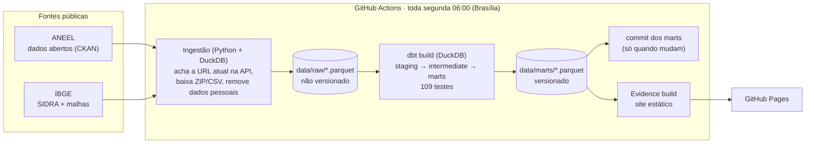

# Geração Solar Distribuída no Brasil

[](https://github.com/vitorsarilio/geracao-solar-brasil/actions/workflows/pipeline.yml)
[](https://github.com/vitorsarilio/geracao-solar-brasil/actions/workflows/ci.yml)

**Dashboard: [vitorsarilio.github.io/geracao-solar-brasil](https://vitorsarilio.github.io/geracao-solar-brasil/)**

Pipeline de dados de ponta a ponta, com **custo zero** e rodando **100% na nuvem**. Toda semana, ele baixa os dados abertos da ANEEL sobre **micro e minigeração distribuída (MMGD) solar**, modela tudo com **dbt + DuckDB**, roda 131 testes e publica um dashboard estático feito com **Evidence.dev** no **GitHub Pages**.

## Pergunta de negócio

A geração distribuída solar (sistemas em telhados e terrenos de casas, comércios, propriedades rurais e indústrias) virou uma das principais fontes de expansão da matriz elétrica brasileira. Para quem planeja rede, vende equipamentos ou formula política pública, a pergunta é **onde e como essa capacidade está crescendo**:

1. Como a potência instalada de GD solar cresceu ao longo do tempo?
2. Quais estados e municípios concentram mais geração, em valor absoluto e per capita?
3. Como a geração se divide por classe de consumo (residencial, comercial, rural...)?
4. Onde o crescimento está acelerando e onde está estabilizando?

## Principais achados

> Dados da ANEEL publicados em **10/10/2026** (conexões até 31/08/2026). O [dashboard](https://vitorsarilio.github.io/geracao-solar-brasil/) é atualizado toda semana; os números abaixo são uma fotografia dessa publicação.

**1. Crescimento.** O Brasil tem **53,8 GW** de GD solar em **4,67 milhões de sistemas** (média de 11,5 kW cada), presentes em 5.567 dos 5.571 municípios. A potência acumulada saiu de 2,3 GW no fim de 2019 para 20,2 GW em 2022 e 49,2 GW em 2025. O ano recorde foi **2024, com 10,7 GW conectados**. Houve um pico de conexões entre dezembro de 2022 e março de 2023 (acima de 1 GW por mês), que coincide com o prazo da Lei 14.300/2022 para manter as regras antigas de compensação, e uma queda logo depois.

**2. Onde está a geração.**
- **Estados:** **São Paulo** lidera em potência (7,6 GW, 14% do país), seguido de Paraná (6,9 GW) e Minas Gerais (6,4 GW). Os 5 maiores somam 52% do total.
- **Por habitante:** quem lidera é **Mato Grosso**, com **808 W por habitante** (a média nacional é 251), seguido de Mato Grosso do Sul (655) e Paraná (574). Amazonas (104), Rio de Janeiro (119) e Sergipe (138) ficam no fim da lista.
- **Regiões:** Centro-Oeste (467 W/hab.) e Sul (416 W/hab.) têm mais que o dobro de Sudeste (195) e Nordeste (192).
- **Municípios:** em valor absoluto, lideram Brasília (590 MW), Cuiabá (511 MW) e Campo Grande (440 MW). Por habitante, entre cidades com mais de 100 mil habitantes, o destaque é o **oeste do Paraná**: Foz do Iguaçu (1.344 W/hab.), Toledo (1.218) e Umuarama (1.172). O Paraná tem 9 dos 20 municípios com mais de 50 mil habitantes no topo do ranking per capita.

**3. Classes de consumo.** **Residencial** responde por **53%** da potência (28,5 GW), seguida de comercial (27%), rural (12%) e industrial (7%). Os sistemas residenciais são pequenos (7,5 kW em média) e numerosos; os industriais têm 64 kW em média. A fatia residencial na potência conectada a cada ano vem subindo: 38% em 2018, 55% em 2022 e 66% em 2026 (até agosto).

**4. Aceleração.** Nos 12 meses até maio de 2026, o país conectou **8,9 GW, 18% a menos** que nos 12 meses anteriores (10,9 GW). Pelo critério do projeto (±20%), isso fica em **"Estável"**, já perto do limite de desaceleração.
- **Acelerando:** Distrito Federal (+31%), Tocantins (+28%) e Paraíba (+25%).
- **Desacelerando:** 7 estados, com as maiores quedas em Goiás (−55%), Alagoas (−50%) e Mato Grosso do Sul (−35%). São Paulo também caiu 31%.
- **Estáveis:** 16 estados.
- **Roraima:** fica de fora da classificação, porque a distribuidora local passou meses sem registrar nenhuma conexão (lacuna de dados, não queda real).
- **Municípios:** entre os que têm volume suficiente para comparar, 574 aceleram, 928 estão estáveis e 1.131 desaceleram.

## Arquitetura



| Decisão | Por quê |
|---|---|
| **Tudo no GitHub Actions + Pages** | Custo zero em repositório público e nada depende de uma máquina ligada. |
| **DuckDB como motor** | Processa 4,7 milhões de linhas em segundos dentro do runner, sem servidor de banco. |
| **Dado bruto fora do git, marts dentro** | O bruto (~110 MB) é baixado de novo a cada execução. Os marts (~1 MB) ficam versionados: guardam o histórico e alimentam o site. |
| **Commit só quando os marts mudam** | Os Parquet são determinísticos: a soma usa `DECIMAL` em vez de ponto flutuante, então o mesmo dado gera o mesmo arquivo. Se a ANEEL passar 45 dias sem publicar, um commit de verificação evita que o GitHub desative o agendamento (ele desativa após 60 dias sem atividade). |
| **URL da fonte descoberta pela API** | A ANEEL pode trocar o ID de cada arquivo; o pipeline procura o recurso pelo nome a cada execução. |
| **Mês de referência calculado a partir dos dados** | As distribuidoras cadastram conexões com atraso (em out/2026, agosto tinha ~5% de um mês normal). O último mês com pelo menos 80% da média dos 12 anteriores vira referência; os seguintes aparecem como provisórios. Sem isso, o país inteiro pareceria em queda. |

## Modelagem (dbt)

| Camada | Modelos | O que faz |
|---|---|---|
| **staging** | `stg_aneel__empreendimentos_gd`, `stg_aneel__gd_fotovoltaica_tecnico`, `stg_ibge__populacao_municipios` | Tipagem (decimal com vírgula, datas), nomes padronizados, limpeza (datas "1900-01-01" viram nulo, "Centro Oeste" vira "Centro-Oeste") |
| **intermediate** | `int_gd_solar__empreendimentos`, `int_gd_solar__periodo_referencia` | Filtra só solar, junta a data de conexão (que só existe no arquivo técnico) e rotula as classes; calcula o mês de referência |
| **marts** | `fct_gd_solar_mensal`, `mart_gd_solar_uf`, `mart_gd_solar_municipio`, `mart_gd_solar_classe_anual`, `mart_gd_solar_aceleracao`, `mart_gd_solar_resumo` | Uma tabela por pergunta de negócio, exportada como Parquet para `data/marts/` |

Duas tabelas de referência (seeds) completam os modelos: rótulos das classes de consumo e nomes/códigos das UFs.

### Qualidade de dados

- **109 testes no dbt:**
  - unicidade, nulos, valores aceitos e faixas válidas;
  - relações entre as fontes (todo município casa com o IBGE, todo sistema do arquivo técnico existe na relação principal);
  - testes genéricos próprios: proporção máxima de nulos e contagem de linhas;
  - **reconciliação:** o total de potência de cada mart bate com a camada intermediária, e o acumulado nunca diminui.
- **22 testes no pytest** cobrem a ingestão: leitura do CSV, remoção dos dados pessoais, normalização e respostas das APIs. Rodam sem internet.
- **Controle de atualização:** o dbt avisa se a ANEEL passar 45 dias sem publicar.
- **Defeitos reais da fonte tratados na ingestão:**
  - aspas soltas dentro de campos de texto;
  - um registro partido em duas linhas;
  - instabilidade do portal (novas tentativas por até ~6 minutos, mais 3 tentativas do passo inteiro no workflow).

## Fontes, privacidade e licença dos dados

| Fonte | Uso | Licença |
|---|---|---|
| [ANEEL – Relação de Empreendimentos de Geração Distribuída](https://dadosabertos.aneel.gov.br/dataset/relacao-de-empreendimentos-de-geracao-distribuida) | Sistemas de GD: UF, município, classe, fonte, potência e data de conexão | ODbL |
| [IBGE – SIDRA, tabela 6579](https://sidra.ibge.gov.br/tabela/6579) | Estimativa da população por município (per capita) | Dados públicos |
| [IBGE – Malhas territoriais](https://servicodados.ibge.gov.br/api/docs/malhas) | Contorno das UFs no mapa | Dados públicos |

**Privacidade:** a base da ANEEL traz CPF/CNPJ, nome do titular e CEP. Essas colunas são **descartadas na ingestão, antes de qualquer arquivo ser gravado**, e o pipeline falha se alguma delas aparecer no resultado. Tudo o que é publicado está agregado no mínimo por município.

## Como rodar localmente (Windows/PowerShell)

**Pré-requisitos:** Git, Python 3.12+ e Node.js 20+ (só para o site).

```powershell
git clone https://github.com/vitorsarilio/geracao-solar-brasil.git
cd geracao-solar-brasil

# Ingestão + dbt (cria o .venv na primeira vez e baixa ~220 MB da ANEEL)
.\scripts\run.ps1

# Mesma coisa e ainda abre o dashboard em modo de desenvolvimento
.\scripts\run.ps1 -Dev
```

Opções do script: `-PularIngestao` reaproveita o que já está em `data/raw/`; `-Site` gera o site estático em `dashboard/build/`. Se o PowerShell bloquear o script, libere para a sessão atual com `Set-ExecutionPolicy -Scope Process Bypass`.

> **Não commite os marts gerados localmente.** No Windows, o DuckDB grava os mesmos valores com bytes diferentes dos do Linux, e o git veria isso como mudança. Os arquivos de `data/marts/` são commitados só pelo GitHub Actions. Para descartar os locais: `git checkout -- data/marts`.

Os passos manuais, caso prefira:

```powershell
python -m venv .venv
.\.venv\Scripts\pip install -r requirements.txt
.\.venv\Scripts\python -m ingestao          # data/raw/*.parquet
.\.venv\Scripts\pytest -q                   # testes da ingestão

cd transform
..\.venv\Scripts\dbt deps
..\.venv\Scripts\dbt build                  # data/marts/*.parquet + testes

cd ..\dashboard
npm ci
npm run sources
npm run dev                                 # http://localhost:3000/geracao-solar-brasil
```

## Estrutura

```
├── .github/workflows/
│   ├── pipeline.yml          # agendado: ingestão → dbt → commit → site → Pages
│   └── ci.yml                # PRs: pytest, ingestão, dbt e build do site
├── ingestion/
│   ├── ingestao/             # python -m ingestao (CKAN, download, Parquet, IBGE)
│   └── tests/                # pytest
├── transform/                # projeto dbt (staging, intermediate, marts, seeds, testes)
├── data/
│   ├── raw/                  # dado bruto (fora do git)
│   └── marts/                # tabelas finais em Parquet (versionadas)
├── dashboard/                # Evidence.dev (páginas, fonte DuckDB, malha das UFs)
└── scripts/
    ├── run.ps1               # roda tudo no Windows
    └── commitar_marts.sh     # regra de commit dos marts no Actions
```

## Limitações

- **Meses recentes incompletos:** os números dos últimos meses ainda crescem nas próximas publicações; o dashboard marca esses meses como provisórios.
- **Lacunas por distribuidora:** quando uma distribuidora para de enviar dados, o estado parece parado (hoje, Roraima).
- **Classe REBR:** a ANEEL publica sem descrição. Ela foi agrupada em Residencial, porque 99% dos registros estão no subgrupo tarifário B1 (residencial).
- **Evidence.dev:** o framework estático open-source está em modo "legacy" desde 2026 (a empresa migrou para o Evidence Studio). As versões estão fixadas; a alternativa estática equivalente seria o Observable Framework. Ele também formata números no padrão americano (ponto decimal).

## Licença

- **Código:** [MIT](LICENSE).
- **Dados derivados** (`data/marts/`): **ODbL**, como a base original. Fonte: Agência Nacional de Energia Elétrica (ANEEL).
