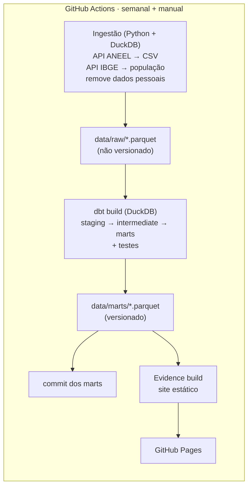

# Geração Solar Distribuída no Brasil

> 🚧 Em construção. Este README será completado ao longo das etapas do projeto.

Pipeline de dados de ponta a ponta, com custo zero e rodando 100% na nuvem. Toda semana, ele baixa os dados abertos da ANEEL sobre **geração distribuída (GD) solar**, modela os dados com dbt + DuckDB e publica um dashboard estático com Evidence.dev no GitHub Pages.

## Perguntas de negócio

1. Como a potência instalada de GD solar cresceu ao longo do tempo?
2. Quais estados e municípios concentram mais geração, em valor absoluto e per capita?
3. Como a geração se divide por classe de consumo (residencial, comercial, rural...)?
4. Onde o crescimento está acelerando e onde está estabilizando?

## Arquitetura



- **O dado bruto não é versionado**: ele é baixado de novo a cada execução.
- **Os marts (tabelas finais, em Parquet) são versionados**: o workflow faz commit deles toda semana. Isso guarda o histórico e mantém o repositório ativo, para o GitHub não desativar o agendamento.

## Fontes de dados

| Fonte | Conteúdo | Licença |
|---|---|---|
| [ANEEL – Relação de Empreendimentos de Geração Distribuída](https://dadosabertos.aneel.gov.br/dataset/relacao-de-empreendimentos-de-geracao-distribuida) | Empreendimentos de GD: UF, município, classe de consumo, fonte e potência; data de conexão (arquivo técnico de fotovoltaica) | ODbL |
| [IBGE – SIDRA, tabela 6579](https://sidra.ibge.gov.br/tabela/6579) | Estimativa da população residente por município | Dados públicos |

**Privacidade:** a base da ANEEL tem CPF/CNPJ, nome do titular e CEP. Essas colunas são descartadas já na ingestão e nunca são gravadas nem versionadas. Os marts publicados são agregados, no máximo por município.

## Estrutura

```
├── .github/workflows/   # pipeline agendado e CI
├── ingestion/           # Python: download e conversão para Parquet
├── transform/           # dbt: staging → intermediate → marts
├── data/marts/          # tabelas finais versionadas (Parquet)
├── dashboard/           # Evidence.dev
└── scripts/             # atalhos para rodar localmente (PowerShell)
```

## Como rodar localmente

_A ser documentado na etapa 8._

## Principais achados

_A ser escrito com base nos dados reais, na etapa 8._

## Licença

- **Código:** [MIT](LICENSE).
- **Dados derivados** (`data/marts/`): **ODbL**, como a base original da ANEEL. Fonte: Agência Nacional de Energia Elétrica (ANEEL).
